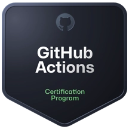
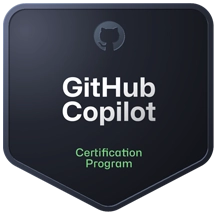
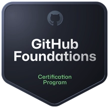
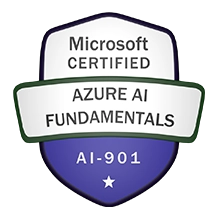
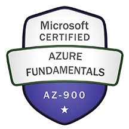
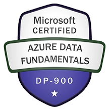

# Hi there, I'm Sunjit S. Nair 👋

## 🏅 My GitHub Certifications

---

## 🏅 My Microsoft Certifications

### 🛠️ Core Stack & Tools
- **Automation / CI/CD:** GitHub Actions 
- **AI-Assisted Development:** GitHub Copilot
- **Security:** GitHub Advanced Security (GHAS), CodeQL, Secret Scanning

<!--
**sunjit41/sunjit41** is a ✨ _special_ ✨ repository because its `README.md` (this file) appears on your GitHub profile.

Here are some ideas to get you started:

- 🔭 I’m currently working on ...
- 🌱 I’m currently learning ...
- 👯 I’m looking to collaborate on ...
- 🤔 I’m looking for help with ...
- 💬 Ask me about ...
- 📫 How to reach me: ...
- 😄 Pronouns: ...
- ⚡ Fun fact: ...
-->
